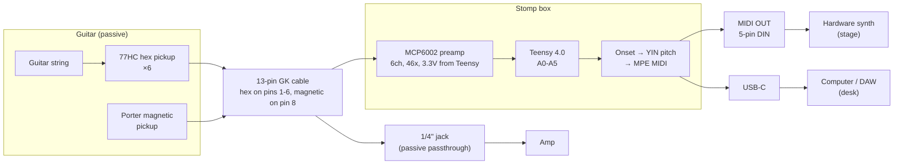

# MIDI Guitar Build

A DIY guitar that doubles as a polyphonic MIDI controller. Six individual
single-string pickups feed a Teensy 4.0, which converts each string's vibration
into MIDI in real time — pitch, note on/off, and per-string pitch bend — using
the MPE (MIDI Polyphonic Expression) standard so every string lives on its own
channel and bends independently.

It's a _hybrid_ instrument: alongside the six hex pickups there's one standard
magnetic pickup, so it still plays and sounds like a normal guitar through an amp
while the digital side drives synths.

The electronics don't live in the guitar. The body carries pickups and a single
**13-pin (Roland GK standard) socket**; everything else — preamp, Teensy, MIDI
OUT, jacks — lives in a stompbox on the floor. The guitar end is entirely
passive.

## Status

**Phase 2 — 6-string expansion (in progress).**

- **Phase 1 (complete):** single-string proof of concept — pickup → buffer → ADC
  → onset detection → YIN pitch detection → MPE MIDI, end-to-end into a DAW.
- **Phase 2 (current):** modular 6-string firmware written; bringing up channels
  one at a time on the breadboard. Single string is working end-to-end on the new
  MCP6002 buffer (no battery). Threshold calibration and per-string gain in
  progress.
- **Phase 3 (planned):** pickups into a real guitar body; everything else into a
  stompbox enclosure, linked by a 13-pin cable. PCB designed and DRC-clean,
  waiting on a cable test before fabrication.
- **Future exploration:** an MPU-6050 accelerometer/gyro on the body or neck to
  turn physical gestures (tilt, shake, orientation) into MIDI CC.

See [`docs/plan.md`](docs/plan.md) for the full phased plan and parts list.

## Signal chain



## Hardware

- **Teensy 4.0** — 600MHz ARM Cortex-M7, dual 12-bit ADC, built-in USB MIDI
- **Ubertar 77HC** single-string ("hexaphonic") pickups ×6
- **MCP6002** rail-to-rail op-amps ×3 (dual channel each = 6 buffer/gain stages),
  running on 3.3V from the Teensy — replaced the original TL072 + 9V battery
- **Porter Pickups** Filtertron-sized humbucker (neck) → 13-pin pin 8 → 1/4" jack
  for analog tone. Boise-made
- **Custom PCB** — 82 × 156 mm, 2-layer, all through-hole. Generated from
  scripts, not hand-drawn; see `hardware/` and `scripts/`
- Breadboard prototype today; the board is designed but not yet fabricated

Circuit of record: [`docs/buffer_circuit.md`](docs/buffer_circuit.md).
Stomp box design: [`docs/stompbox/`](docs/stompbox/README.md).

## Firmware

Arduino IDE + Teensyduino. Under `firmware/`:

- **`firmware/adc_test/`** — Phase 1 single-string sketch. Uses the Teensy Audio
  library + USB Audio for monitoring; YIN pitch detection.
- **`firmware/experiments/`** — sketches that are **not** part of the MIDI signal
  chain and aren't headed for the pedal. Currently the ILI9341 waveform display,
  parked as a bench tool. Its README records why.
- **`firmware/guitar_midi/`** — Phase 2 modular 6-string firmware. MIDI only
  (no USB Audio). Components:
  - `config.h` — all tunable constants (thresholds, sample rate, MIDI, per-string)
  - `adc_sampler.h/.cpp` — timer-driven 20kHz ADC sampling, 6 channels, per-channel ring buffers
  - `onset_detector.h/.cpp` — RMS-based per-string note on/off state machine
  - `pitch_detector.h/.cpp` — YIN pitch detection with hysteresis
  - `midi_output.h/.cpp` — MPE MIDI output with per-channel pitch bend tracking
  - `guitar_midi.ino` — orchestrator with staggered per-string pitch detection

### Flashing

1. Open the sketch in the Arduino IDE with Teensyduino installed.
2. Select **Tools → Board → Teensy 4.0**.
3. Set **Tools → USB Type → "Serial + MIDI"** (Phase 2). The Phase 1 `adc_test`
   sketch uses **"Serial + MIDI + Audio"**.
4. Upload. The Teensy enumerates as a USB MIDI device — add it as an MPE
   instrument in your DAW.

> **Power note:** don't power the Teensy via VIN and USB at the same time without
> cutting the VIN-VUSB trace.

## Tooling

`scripts/` holds host-side helpers for bring-up and debugging:

- `teensy_serial.py` — serial reader for the Teensy CDC port
- `guitar_monitor.py` — live monitoring of onset / pitch output

## Repository layout

```text
firmware/        Teensy sketches
  adc_test/        Phase 1 single-string
  guitar_midi/     Phase 2 modular 6-string (the real one)
  experiments/     parked, not in the signal chain
hardware/        KiCad schematic + PCB — GENERATED, do not hand-edit
docs/            build plan, hardware references, circuit + design notes
  stompbox/        enclosure: power, controls, pin map, prior art
scripts/         KiCad generators + host-side serial/debug tools
enclosure/       OpenSCAD models (pickup enclosure)
brainstorm/      concept sketches
output/          captured stage notes / logs
CLAUDE.md        project instructions for Claude Code
```

`hardware/` is generated by `scripts/gen_kicad_schematic.py` and
`scripts/gen_kicad_pcb.py`. Regenerate in order — schematic →
`check_kicad_netlist.py` → PCB — and never hand-edit the KiCad files.

## Documentation

| Doc                                                          | What's in it                                                     |
| ------------------------------------------------------------ | ---------------------------------------------------------------- |
| [`docs/plan.md`](docs/plan.md)                               | Phased build plan, parts list, signal chain, technical notes     |
| [`docs/guitar_build.md`](docs/guitar_build.md)               | Physical build specs and decisions                               |
| [`docs/body_shape.md`](docs/body_shape.md)                   | Body outline design (Jazzmaster × Iceman hybrid)                 |
| [`docs/wood_comparison.md`](docs/wood_comparison.md)         | Body / neck / fretboard tonewood comparison                      |
| [`docs/pickup_selection.md`](docs/pickup_selection.md)       | Standard magnetic pickup selection (Porter Pickups)              |
| [`docs/buffer_circuit.md`](docs/buffer_circuit.md)           | **Circuit of record** — schematic, values, BOM, bring-up         |
| [`docs/stompbox/`](docs/stompbox/README.md)                  | Stomp box: I/O, power, controls, Teensy pin map, prior art       |
| [`docs/wip.md`](docs/wip.md)                                 | ⚠️ Historical Phase-1 breadboard wiring (TL072 + 9V). Superseded |
| [`docs/teensy-4.0.md`](docs/teensy-4.0.md)                   | Teensy 4.0 pinout / reference                                    |
| [`docs/ubertar-77hc-pickup.md`](docs/ubertar-77hc-pickup.md) | Ubertar 77HC pickup reference                                    |
